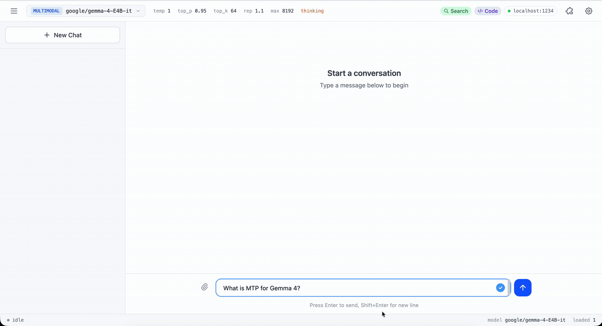

<a name="top"></a>
<p align="center">
  <picture>
    <source media="(prefers-color-scheme: dark)" srcset="docs/assets/logo-dark.png">
    
  </picture>
</p>

<p align="center"><b>One Rust engine for text, vision, speech and images.</b><br>
Serve it over OpenAI- and Anthropic-compatible HTTP, or embed it from Rust, Python, C# or C.</p>

<p align="center">
  <a href="docs/src/content/docs/quickstart.mdx"><b>Quickstart</b></a> |
  <a href="docs/src/content/docs/index.mdx"><b>Documentation</b></a> |
  <a href="docs/src/content/docs/reference/supported-models.md"><b>Supported models</b></a> |
  <a href="docs/src/content/docs/reference/http-api.md"><b>HTTP API</b></a> |
  <a href="docs/src/content/docs/guides/python/getting-started.mdx"><b>Python</b></a> |
  <a href="docs/src/content/docs/guides/rust/getting-started.mdx"><b>Rust</b></a> |
  <a href="bindings/csharp/README.md"><b>C#</b></a>
</p>

<p align="center">
  <a href="https://github.com/christopherthompson81/inference.rs/stargazers">
    
  </a>
</p>

---

inference.rs loads a model from a Hugging Face repo, a local directory or a GGUF file. It works out the architecture,
weight format and chat template itself, and runs on CUDA, Metal or the CPU. The same engine sits behind the
`inference` CLI, the HTTP server, the built-in web UI, the Rust SDK and a C ABI. The Python and C# packages are
bindings over that ABI, so every surface does the same things.

## What it runs

| | |
|---|---|
| **Text** | Llama, Qwen 2-3.6, Gemma 1-4, Mistral, Phi, DeepSeek V2/V3/R1, GLM-4, GPT-OSS, Granite 4, LFM2 and more, dense and MoE; block-diffusion text with DiffusionGemma |
| **Vision and video** | Qwen-VL 2-3.6, Gemma 3/3n/4, Llama 3.2 Vision and Llama 4, LLaVA, Idefics, SmolVLM, Phi-4-multimodal, MiniCPM-o, PaddleOCR-VL |
| **Speech recognition** | NVIDIA Parakeet (CTC, RNN-T, TDT) and Nemotron streaming ASR, from transformers, `.nemo` or GGUF, with word timestamps and beam search; Voxtral Realtime |
| **Speaker and voice activity** | Nemotron-3 Diarization and Streaming Sortformer (who speaks when), Silero VAD |
| **Speech synthesis** | Kokoro (9 languages) and Dia |
| **Image generation** | FLUX.1, from safetensors or GGUF |
| **Embeddings and documents** | EmbeddingGemma, Qwen3 Embedding; PP-DocLayoutV3 document layout detection |

The **[supported models reference](docs/src/content/docs/reference/supported-models.md)** lists every architecture
with a copy-paste command. It is generated from the engine's loader registry.

## Quick start

**Install** a prebuilt binary (Metal on Apple Silicon, CUDA or CPU on Linux, CPU on Windows):

```bash
curl -fsSL https://raw.githubusercontent.com/christopherthompson81/inference.rs/master/install.sh | sh
```

```powershell
irm https://raw.githubusercontent.com/christopherthompson81/inference.rs/master/install.ps1 | iex
```

The installer falls back to a source build when no binary matches. Standard acceleration needs neither Rust nor the
CUDA toolkit. [Manual installation and other platforms](docs/src/content/docs/quickstart.mdx).

**Chat**, interactively or with one prompt:

```bash
inference run -m Qwen/Qwen3-4B
inference run -m google/gemma-4-E4B-it --image photo.jpg -i "Describe this image"
inference run -m unsloth/Qwen3.5-4B-GGUF --quant 4          # a published 4-bit GGUF
inference run --agent -m Qwen/Qwen3-4B                      # with web search, Python and a shell
```

**Serve** a model, then use any OpenAI or Anthropic client against `http://localhost:1234/v1`. The web UI is at
`http://localhost:1234/ui`.

```bash
inference serve -m google/gemma-4-E4B-it
```

The same command serves the other model kinds through their OpenAI-style endpoints:

```bash
# speech recognition
inference serve -m nvidia/parakeet-tdt-0.6b-v3
curl localhost:1234/v1/audio/transcriptions -F file=@meeting.wav -F response_format=verbose_json

# text to speech
inference serve -m hexgrad/Kokoro-82M
curl localhost:1234/v1/audio/speech -H "Content-Type: application/json" \
  -d '{"model": "default", "input": "Hello world.", "voice": "af_heart"}' --output hello.wav

# image generation
inference serve -m black-forest-labs/FLUX.1-schnell
curl localhost:1234/v1/images/generations -H "Content-Type: application/json" \
  -d '{"prompt": "a lighthouse at dusk", "width": 1024, "height": 1024, "response_format": "b64_json"}'
```

<details>
  <summary><b>Web UI demo</b></summary>
  <br>
  
</details>

## Serving

`inference serve` exposes one HTTP API per process, for as many models as you load. You can add, unload and alias
models at runtime.

| Area | Endpoints |
|---|---|
| Chat and text | `/v1/chat/completions`, `/v1/completions`, `/v1/responses`, Anthropic `/v1/messages` |
| Audio | `/v1/audio/transcriptions`, `/v1/audio/speech`, `/v1/audio/diarization`, `/v1/audio/vad` |
| Images and embeddings | `/v1/images/generations`, `/v1/embeddings` |
| Agents and files | `/v1/files`, `/v1/skills`, `/v1/sessions`, agent approvals |
| Operations | `/v1/models` (add, unload, reload, tune), `/metrics` (Prometheus), `/v1/system/doctor` |

- **API keys:** keyed mode gives each client its own sessions and files.
- **MCP:** the server can expose itself as an MCP server, and it can call out to MCP tools.
- **Details:** the [HTTP API reference](docs/src/content/docs/reference/http-api.md) and the
  [OpenAI compatibility notes](docs/src/content/docs/reference/openai-compatibility.md) say what each endpoint
  accepts.

## Embedding the engine

| | |
|---|---|
| **Rust** | `cargo add inference --git https://github.com/christopherthompson81/inference.rs`. Builders for every model kind and typed requests. [Get started](docs/src/content/docs/guides/rust/getting-started.mdx), [examples](examples/rust) |
| **Python** | A pure-Python package (`inference_rs`) over the C ABI; the wheel bundles the engine for CPU, CUDA or Metal. [Get started](docs/src/content/docs/guides/python/getting-started.mdx), [examples](examples/python) |
| **C#** | .NET bindings with streaming, host tools and the document layout model. [README](bindings/csharp/README.md) |
| **C** | `libinference_ffi` with [`include/inference.h`](crates/inference-ffi/include/inference.h): JSON in, JSON out, for any language with a C FFI |

The C ABI is the top-level surface: a test fails when a public engine method has no ABI entry. A host program in
another language gets everything the HTTP server can do.

## Performance and quantization

- **Batching and caching:** continuous batching everywhere. [PagedAttention](docs/src/content/docs/guides/perf/paged-attention.mdx) and prefix caching (multimodal included) on CUDA and Apple Silicon.
- **Attention kernels:** FlashAttention on CUDA, including FP8 and paged variants; Metal kernels on macOS.
- **Scaling and decoding:** [multi-GPU and distributed inference](docs/src/content/docs/guides/perf/distributed-inference.mdx) (tensor parallel, layer mapping, multi-node), and [speculative decoding](docs/src/content/docs/guides/perf/speculative-decoding.mdx).
- **Quantization:**
  - [GGUF](docs/src/content/docs/reference/gguf-support.md) at 2-8 bits, including the IQ and trellis types;
  - GPTQ, AWQ, HQQ, FP8 and bitsandbytes checkpoints;
  - [in-situ quantization](docs/src/content/docs/guides/quantization/quantize-a-model.mdx) of any Hugging Face model at load;
  - prebuilt [UQFF](docs/src/content/docs/reference/uqff-format.md) files.
  
  `--quant` picks the right one for a repo. [Per-layer topology](docs/src/content/docs/guides/perf/topology.mdx) sets the quantization layer by layer.
- **Tuning:** `inference tune` recommends quantization and device mapping for your model and hardware, and `inference bench` measures it.

## Agents and tools

- **Tool calls:** [tool calling](docs/src/content/docs/guides/agents/tool-calling-basics.mdx) with grammar-constrained arguments and strict schemas. Structured output through JSON Schema, regex or Lark grammars.
- **Agentic loop:** a server-side [agentic loop](docs/src/content/docs/guides/agents/index.md) that runs tools and feeds results back. It comes with sandboxed [Python](docs/src/content/docs/guides/agents/enable-code-execution.mdx) and [shell](docs/src/content/docs/guides/agents/enable-shell.mdx) sessions, [web search](docs/src/content/docs/guides/agents/web-search.mdx), approvals and persistent sessions.
- **Compatible features:** OpenAI-compatible [Skills](docs/src/content/docs/guides/agents/skills.mdx) and [file inputs](docs/src/content/docs/guides/agents/file-inputs.mdx), and an [MCP client](docs/src/content/docs/guides/agents/connect-mcp-server.mdx).
- **Adapters:** [LoRA adapters](docs/src/content/docs/guides/customize/lora-adapters.mdx), chosen per request and hot-swapped live.

## Building from source

```bash
cargo build --release --features cuda      # or: --features metal, or neither for CPU
cargo install --path crates/inference-cli --features cuda
```

[Building from source](docs/src/content/docs/developer/from-source.md) covers feature flags, toolchains and the
CUDA build. [Architecture](docs/src/content/docs/developer/architecture.md) maps the crates. A
[Docker guide](docs/src/content/docs/guides/deploy/docker.md) covers containers.

## Documentation

- [Quickstart](docs/src/content/docs/quickstart.mdx): install, first run, first server
- [CLI reference](docs/src/content/docs/reference/cli/index.md): `run`, `serve`, `bench`, `tune`, `quantize`, `doctor` and the rest
- [Speech models](docs/src/content/docs/guides/models/use-speech-models.mdx), [image generation](docs/src/content/docs/guides/models/use-image-generation.mdx), [multimodal input](docs/src/content/docs/guides/models/multimodal-input.mdx), [embeddings](docs/src/content/docs/guides/models/use-embeddings.mdx)
- [Quantization types](docs/src/content/docs/reference/quantization-types.md) and [hardware support](docs/src/content/docs/reference/hardware-support.md)
- [Troubleshooting](docs/src/content/docs/reference/troubleshooting.md) and [environment variables](docs/src/content/docs/reference/environment-variables.md)

## Origins and credits

inference.rs began as a fork of [mistral.rs](https://github.com/EricLBuehler/mistral.rs) by Eric Buehler, and its
engine still builds on that work. Its tensor layer derives from Hugging Face's
[Candle](https://github.com/huggingface/candle). It was renamed because it outgrew language models: speech, image,
diarization and document models now sit beside the LLMs, behind a C ABI for other languages.

Crates are `inference-*` (the Rust SDK is `inference`), the binary is `inference`, the Python package is
`inference_rs`, and environment variables use `INFERENCE_RS_*`. inference.rs is not affiliated with Mistral AI. See
[LICENSE](LICENSE). To cite the original work, use [CITATION.cff](CITATION.cff).

Issues and contributions are welcome: [open an issue](https://github.com/christopherthompson81/inference.rs/issues)
to report a bug, propose a feature or ask for a model.

<p align="right"><a href="#top">Back to top</a></p>
